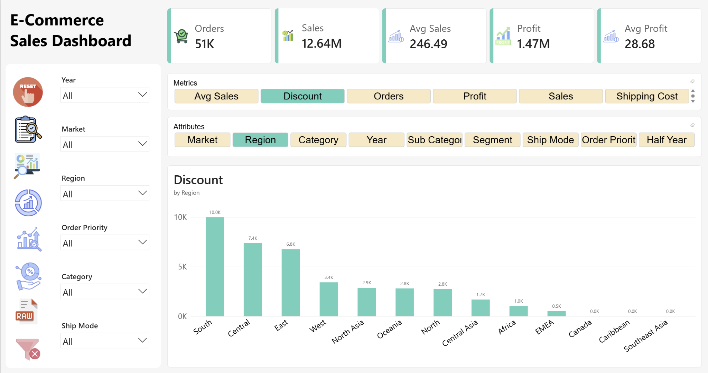
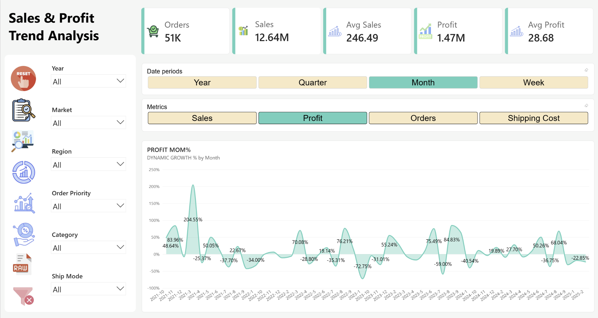
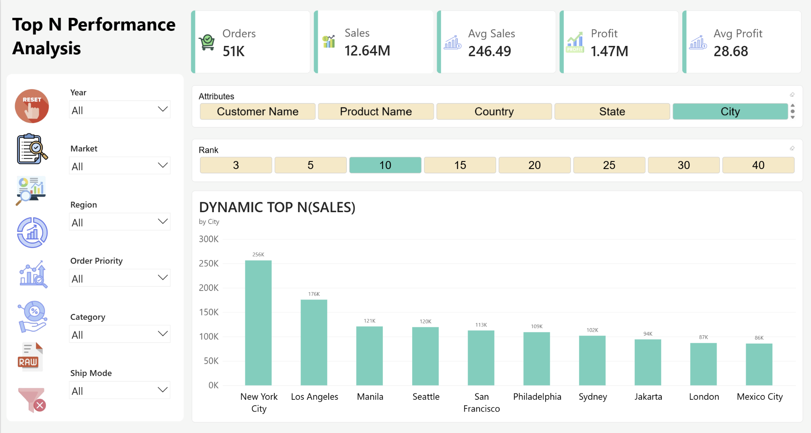
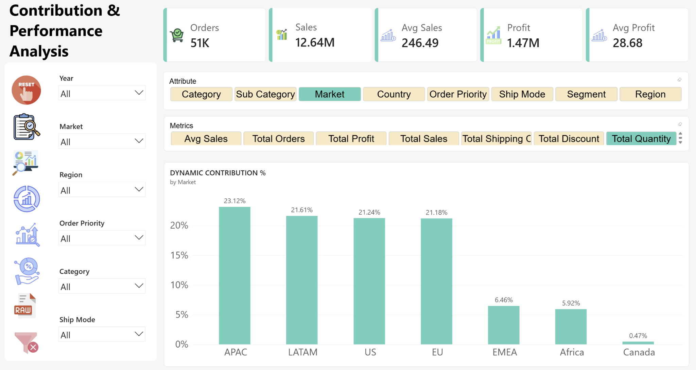
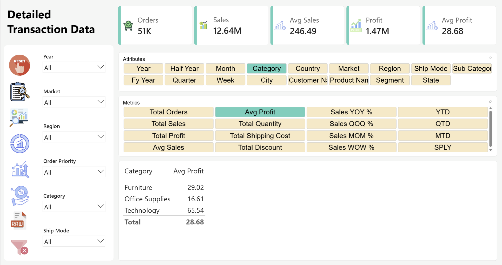
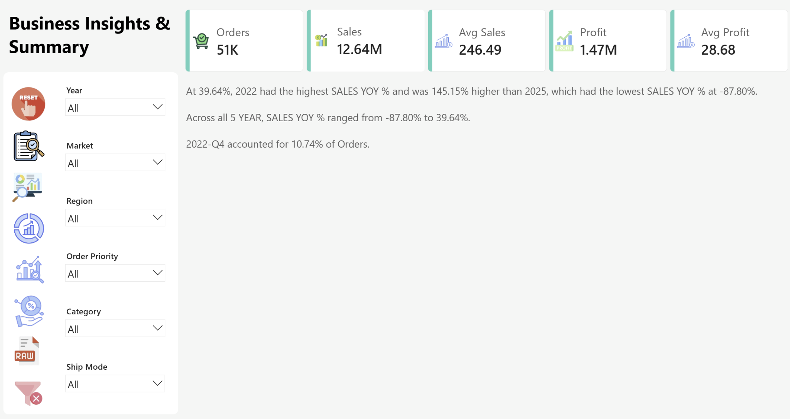

<div align="center">

# 🌍 E-Commerce Sales Analysis

### An interactive Power BI dashboard for analysing global sales, profitability, customer and product performance.




</div>

---

## 📑 Table of Contents

1. [Project Overview](#-project-overview)
2. [Business Problem](#-business-problem)
3. [Dashboard Pages](#-dashboard-pages)
4. [Key Insights](#-key-insights)
5. [Dataset](#️-dataset)
6. [KPI Definitions](#-kpi-definitions)
7. [Tools & Technologies](#️-tools--technologies)
8. [Repository Structure](#-repository-structure)
9. [How to Use](#-how-to-use)
10. [Author](#-author)

---

## 🎯 Project Overview

The **Global Superstore Sales Analysis** project is an end-to-end business analytics project developed using **SQL Server and Microsoft Power BI**. It explores sales transactions across different markets, regions, countries, customer segments, product categories and shipping modes.

The project combines SQL-based business analysis with an interactive Power BI dashboard to understand overall business performance, identify sales and profit trends, compare market contributions, evaluate product and customer performance, and examine discount and shipping patterns.

The dashboard provides dynamic metric and attribute selections, Top N analysis, time-period analysis, contribution analysis and detailed transaction-level exploration.

### Project Objectives

- Monitor overall sales, profit, order volume and average performance.
- Analyse sales and profit trends across different time periods.
- Identify high-performing and loss-making products and sub-categories.
- Compare performance across markets, regions, countries and cities.
- Understand customer segment and shipping mode performance.
- Evaluate discount patterns and their relationship with profitability.
- Present business insights through an interactive dashboard.

---

## ❓ Business Problem

A global retail business generates transactions across multiple countries, markets, regions, customer segments and product categories. Looking at transaction-level records alone makes it difficult for business teams to understand what drives revenue, where profits are generated, and which areas require attention.

The business needs a consolidated view to answer questions such as:

- How much revenue and profit does the business generate?
- How are sales and profit changing over time?
- Which markets, regions and countries contribute the most?
- Which products and sub-categories generate the highest sales and profit?
- Which products are generating losses?
- Which customer segments contribute the most revenue?
- How do discount levels relate to sales and profitability?
- Which shipping modes contribute the most orders and sales?
- Which cities lead under dynamic Top N analysis?

This project addresses these questions through SQL queries and an interactive Power BI report.

---

## 📊 Dashboard Pages

The Power BI report contains six main pages. Common filters include Year, Market, Region, Order Priority, Category and Ship Mode, where available on the respective pages.

### 1️⃣ E-Commerce Sales Dashboard

Provides a high-level view of business performance through KPI cards, dynamic metric and attribute selection, and regional comparison.

Key elements:
- Orders, Sales, Average Sales, Profit and Average Profit.
- Dynamic metric selection, including Discount, Orders, Profit, Sales and Shipping Cost.
- Dynamic attribute selection, including Market, Region, Category, Year, Sub-Category, Segment, Ship Mode and Order Priority.
- Discount comparison across regions.


### 2️⃣ Sales & Profit Trend Analysis

Focuses on how business performance changes over time.

Key elements:
- Sales, Profit, Orders and Shipping Cost metric selection.
- Year, Quarter, Month and Week period selection.
- Dynamic time-based trend analysis.
- Month-over-month profit growth analysis.



### 3️⃣ Top N Performance Analysis

Identifies high-performing business entities using dynamic attribute and ranking selections.

Key elements:
- Dynamic attribute selection, such as Customer Name, Product Name, Country, State and City.
- Configurable Top N ranking options.
- Dynamic Top N sales comparison.
- Identification of leading cities and other selected business entities.



### 4️⃣ Contribution & Performance Analysis

Evaluates how selected business attributes contribute to different business metrics.

Key elements:
- Dynamic attribute selection, including Category, Sub-Category, Market, Country, Order Priority, Ship Mode, Segment and Region.
- Dynamic metric selection, including Average Sales, Total Orders, Total Profit, Total Sales, Total Shipping Cost, Total Discount and Total Quantity.
- Contribution percentage analysis across selected attributes.



### 5️⃣ Detailed Transaction Data

Provides a detailed view of business performance at a granular level.

Key elements:
- Dynamic attribute selection across date, product, customer and geographic fields.
- Dynamic metric selection, including sales, profit, quantity, discount and time-intelligence measures.
- Detailed category-level metric comparison.
- Transaction-level exploration with interactive filters.



### 6️⃣ Business Insights & Summary

Presents automatically generated business observations based on selected metrics and time periods.

Key elements:
- Dynamic sales year-over-year observations.
- Identification of highest and lowest annual growth periods.
- Quarterly order contribution observations.
- Narrative-style summaries to support business interpretation.




---

## 📊 Key Business Insights

The analysis of the Global Superstore dataset reveals the following business insights across sales performance, profitability, customer behaviour, geographical distribution, product performance and operational efficiency.

### 1. Overall Business Performance
- The business recorded approximately **12.64M in total sales**, **1.47M in total profit** and **51K orders**.
- The average sales value was **246.49**, while average profit was **28.68**, providing an overview of the overall transaction performance.

### 2. Market and Geographical Performance
- **APAC** recorded the highest Total Profit Contribution at **29.73%**, followed by EU at **25.39%** and US at **19.51%**.
- The **United States** leads country-wise sales with approximately **2.30M**, followed by Australia at **0.93M** and France at **0.86M**.
- **New York City** is the highest-performing city, generating approximately **256K in sales**, followed by Los Angeles at **176K**.
- APAC also recorded the highest Average Sales value at approximately **326**, while EMEA recorded the lowest at approximately **160**.

### 3. Product and Category Performance
- **Technology** is the leading product category, generating approximately **4.7M in sales**, followed by Furniture at **4.1M** and Office Supplies at **3.8M**.
- Technology also recorded the highest average profit at **65.54**, compared with Furniture at **29.02** and Office Supplies at **16.61**.
- **Apple Smart Phone, Full Size** leads the displayed product ranking with approximately **87K in sales**, followed by Cisco and Motorola smartphones.
- The Average Sales Contribution analysis shows Technology at **189.81%** and Furniture at **168.87%**, while Office Supplies records **49.13%**.

### 4. Customer and Order Priority Analysis
- The **Consumer segment** contributes the highest share of total profit at **51.06%**, followed by Corporate at **30.08%** and Home Office at **18.86%**.
- Medium-priority orders account for **58.88% of total profit contribution** and **74.63% of total quantity contribution**.
- Among the displayed customer rankings, **Tom Ashbrook** leads with approximately **40K in sales**, followed by Tamara Chand at **37K** and Greg Tran at **36K**.

### 5. Shipping and Operational Performance
- **Standard Class** dominates shipping performance, contributing approximately **60% of total sales** and **60% of total profit**.
- Technology records the highest shipping cost at approximately **0.51M**, followed by Furniture at **0.44M** and Office Supplies at **0.41M**.
- Discount values vary across half-year periods, with the highest displayed discount of approximately **6.9K in 2021-H1**.

### 6. Sales and Profit Trend Analysis
- Profit recorded strong year-over-year growth of **39.78% in 2022**, followed by a significant decline of **50.69% in 2023**.
- Profit recovered in 2024, recording positive year-over-year growth of **23.65%**.
- Orders followed a similar pattern, growing by **40.01% in 2022**, declining by **48.67% in 2023**, and recovering by **21.83% in 2024**.
- Monthly and quarterly trend analysis reveals considerable fluctuations in sales, profit, orders and shipping costs, highlighting the importance of monitoring business performance across different time periods.

### Overall Business Takeaway
The analysis highlights Technology as the leading sales and profitability category, APAC as the strongest market in profit contribution, the Consumer segment as the largest contributor to profitability, and Standard Class as the dominant shipping mode. The significant decline in 2023 followed by recovery in 2024 also demonstrates the importance of continuous sales and profitability monitoring.

*Note: Numerical findings represent the values displayed in the dashboard. Top N rankings and contribution metrics may vary depending on the selected dashboard attributes, measures and filters.*
---

## 🗄️ Dataset

The project uses the **Global Superstore** dataset provided in the Excel workbook:

[`data/Global_Superstore_Raw_Data.xlsx`](data/Global_Superstore_Raw_Data.xlsx)

The workbook contains a populated worksheet named `GlobalSuperStore` and an empty `Sheet1` worksheet. The populated worksheet is a **single master transaction table** containing order, customer, product, geographic, sales, profit, discount and shipping information.

**This project uses the master table directly. No separate fact/dimension schema or data-model section is included.**

### Dataset Columns

| Column | Description |
|---|---|
| `Order ID` | Unique order identifier |
| `Order Date` | Date on which the order was placed |
| `Ship Mode` | Shipping method used |
| `Customer ID` | Customer identifier |
| `Customer Name` | Customer name |
| `Segment` | Customer segment |
| `City` | City associated with the order |
| `State` | State or province |
| `Country` | Country associated with the order |
| `Postal Code` | Postal or ZIP code |
| `Market` | Market classification |
| `Region` | Geographic region |
| `Product ID` | Product identifier |
| `Category` | Product category |
| `Sub-Category` | Product sub-category |
| `Product Name` | Product name |
| `Sales` | Sales amount |
| `Quantity` | Quantity sold |
| `Discount` | Discount value/rate recorded in the source |
| `Profit` | Profit or loss amount |
| `Shipping Cost` | Shipping cost amount |
| `Order Priority` | Priority assigned to the order |

For additional field details, refer to [`docs/data_dictionary.md`](docs/data_dictionary.md).

### SQL Source Table

The SQL analysis script is written for **SQL Server** and expects the source table name:

`dbo.GlobalSuperStore`

**Column-name note:** The Excel workbook uses headers with spaces (for example, `Order ID`), while the supplied SQL script references underscore-style names (for example, `[Order_ID]`). Rename the columns during SQL Server import or update the SQL identifiers before executing the queries. See [`docs/sql_excel_column_mapping.md`](docs/sql_excel_column_mapping.md).

---

## 📐 KPI Definitions

The following KPI definitions are based on the supplied SQL analysis queries and the metrics displayed in the Power BI report.

| KPI | Mathematical calculation | Columns used |
|---|---|---|
| **Total Sales** | `SUM(Sales)` | Sales |
| **Total Profit** | `SUM(Profit)` | Profit |
| **Total Quantity Sold** | `SUM(Quantity)` | Quantity |
| **Total Orders** | `COUNT(DISTINCT Order ID)` | Order ID |
| **Total Customers** | `COUNT(DISTINCT Customer ID)` | Customer ID |
| **Profit Margin %** | `(Total Profit / Total Sales) × 100` | Profit, Sales |
| **Average Sales** | Average of Sales values at transaction-row level, if implemented as a column average | Sales |
| **Average Profit** | Average of Profit values at transaction-row level, if implemented as a column average | Profit |
| **Average Order Value (AOV)** | Average of order-level sales totals; equivalently Total Sales / distinct orders | Order ID, Sales |
| **Average Shipping Cost** | `AVERAGE(Shipping Cost)` | Shipping Cost |
| **Month-over-Month Sales Growth %** | `((Current Month Sales - Previous Month Sales) / Previous Month Sales) × 100` | Order Date, Sales |
| **Month-over-Month Profit Growth %** | `((Current Month Profit - Previous Month Profit) / Previous Month Profit) × 100` | Order Date, Profit |
| **Year-over-Year Sales Growth %** | `((Current Year Sales - Previous Year Sales) / Previous Year Sales) × 100` | Order Date, Sales |
| **Contribution %** | `(Selected Attribute Metric / Total Metric) × 100` | Selected attribute and selected metric |
| **Top N Performance** | Rank selected attribute entities by selected metric and return the chosen N | Selected attribute and metric |

**Note:** The exact DAX definitions for the Power BI cards and dynamic calculations should be checked against the measures in the PBIX file. Average Sales and Average Profit above describe row-level averages; they should not be confused with Average Order Value or profit per order.

Detailed KPI notes are available in [`docs/kpi_definitions.md`](docs/kpi_definitions.md).

---

## 🛠️ Tools & Technologies

- **Microsoft SQL Server** – querying and business analysis.
- **SQL Server Management Studio (SSMS)** – writing and executing SQL queries.
- **Microsoft Power BI Desktop** – interactive dashboard development and visualization.
- **Power Query** – data loading and transformation.
- **DAX** – KPIs, dynamic metrics, ranking, contribution and time-based calculations.
- **Microsoft Excel** – source dataset.

### SQL Analysis

The SQL script is organized into 15 business analysis sections:

1. Overall Business Performance
2. Yearly Sales and Profit Trend
3. Monthly Sales Trend
4. Category-wise Performance
5. Sub-category Profitability
6. Customer Segment Analysis
7. Market-wise Performance
8. Region-wise Performance
9. Top 10 Countries by Sales
10. Top 10 Customers by Sales
11. Top 10 Products by Sales
12. Discount Impact on Profitability
13. Shipping Mode Analysis
14. Average Order Value (AOV)
15. Month-over-Month Sales Growth

---

## 📁 Repository Structure

```text
E-Commerce-sales-analysis/
│
├── README.md
├── .gitignore
│
├── SQL/
│   └── GSS_Business_Analysis_Queries.sql
│
├── PowerBI/
│   └── E-COMMERECE SALES ANALYSIS.pbix
│
├── data/
│   └── Global_Superstore_Raw_Data.xlsx
│
├── assets/
│   └── screenshots/
│       ├── 01_ecommerce_sales_dashboard.png
│       ├── 02_sales_profit_trend_analysis.png
│       ├── 03_top_n_performance_analysis.png
│       ├── 04_contribution_performance_analysis.png
│       ├── 05_detailed_transaction_analysis.png
│       ├── 06_business_insights_summary.png
│
│
└── docs/
    ├── data_dictionary.md
    ├── kpi_definitions.md
    └── sql_excel_column_mapping.md
```

---

## 🚀 How to Use

### 1. Clone the repository

```bash
git clone https://github.com/boyinaviswanth/E-Commerce_Sales_Analysis
cd global-superstore-sales-analysis
```

### 2. Explore the dataset

Open `data/Global_Superstore_Raw_Data.xlsx` and use the populated `GlobalSuperStore` worksheet.

### 3. Run the SQL analysis

1. Import the Excel worksheet into SQL Server.
2. Use `dbo.GlobalSuperStore` as the table name, or update the SQL script to match your table name.
3. Resolve the Excel/SQL column-name differences using `docs/sql_excel_column_mapping.md`.
4. Open `SQL/GSS_Business_Analysis_Queries.sql` in SSMS.
5. Select the correct database and execute the queries.

### 4. Open the Power BI dashboard

Open `PowerBI/GSS_Sales_Analysis.pbix` using Power BI Desktop. If the source file path differs on your machine, update the data source path and refresh the report.

---

## 👤 Author

**Viswanth Boyina**

- GitHub: https://github.com/boyinaviswanth
- LinkedIn:https://www.linkedin.com/in/boyinaviswanth/

---

<div align="center">

**⭐ If you find this project useful, consider giving the repository a star!**

*This is an independent data analytics portfolio project using the Global Superstore dataset.*

</div>
